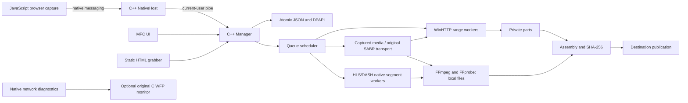

# Native UDM architecture

## 10.8 / browser 0.73.72 — canonical HTTP identity encoding; built, uninstalled

Emit one byte-preserving identity-encoding field for both Windows HTTP and curl, removing internal duplicates before request admission while retaining injection rejection. Frozen/current wire controls cover GET, POST, HEAD, ranges, lower/mixed-case and conflicting fields. All five native programs build; current parallel-origin, POST recovery, admission/decoder/read, metadata, crash, recording and complete-media regressions pass. C: has sufficient build reserve; D: still fails its workspace reserve, so combined delivery acceptance remains false. No installer or installation. [Implementation, complete counts, evidence and next work](http-wire-identity-10.8.md).

## 10.7 / browser 0.73.71 — resume pending resource aliases; built, uninstalled

Fix retries where another saved segment already pins the exact source list of an unfinished segment or initialization file. Only explicit unaccepted pending intents may adopt that known version; accepted data, coordinates, source lists and legacy rules retain their protection. Frozen 10.6 fails both controls; current code resumes without refetching accepted resources. All five native programs build; 107 focused assertions, 17 HTTP cases, three hard-stop cases, seven continuous recordings and nine direct/caption cases pass. Build outputs use C: with sufficient reserve; D: remains below its workspace reserve, so combined delivery acceptance remains false. No installation or installer. [Correction, evidence and ordered next work](dash-pending-alias-10.7.md).

## 10.6 / browser 0.73.70 — single-pass full-resource capture; built, storage reserve not met

Use the same full GET to pin and store a fresh independent DASH SegmentList resource, with a durable version checkpoint before body writes. Preserve ranged-object preflight, compatibility fallback, legacy receipts and strict changed-version rejection. All five native programs build; 107 focused assertions, 17 HTTP workflow cases, three recovery controls, eight freshness controls, seven continuous-recording cases and nine direct/caption media cases pass in the final runs. Initial failures are retained. The final free-space audit is below the unchanged 1 GiB reserve, so combined acceptance remains false and further candidate builds are held. No installer or installation. [Ownership, exact results, failed attempts and ordered follow-up](dash-single-pass-10.6.md).

## 10.5 / browser 0.73.69 — purpose-scoped resource discovery; built, uninstalled

Reuse recording-owned transport for resource-version discovery while isolating manifest, clock and discovery roles even with identical settings. Preserve HEAD/range fallback, strong version checks, cancellation and ownership bounds. All five native programs build; 85 focused assertions, 14 HTTP isolation/discovery requests, eight freshness controls and the production seven-case recording suite pass. Version probes remain; their single-pass response/checkpoint replacement is explicitly planned. No installer or installation. [Implementation, qualification and required next steps](dash-discovery-roles-10.5.md).

## 10.4 / browser 0.73.68 — recording-owned DASH metadata transport; built, uninstalled

Replace per-request metadata session setup with a bounded recording-owned cache, separating origins and complete preferences. Release transports on normal exit and exceptions; keep clock requests anonymous and headers request-local. The 82 lifetime/AAC/boundary assertions, real HTTP isolation checks, held-response cancellation, eight freshness controls and production seven-case continuous recording suite pass. All five native programs build as 10.4; no installer or installation. [Ownership rules, exact scope, build attempts and remaining work](dash-metadata-transport-10.4.md).

## 10.3 / browser 0.73.67 — bounded live-manifest freshness recovery; built, full acceptance incomplete

Recover from a transiently expired manifest or clock response within at most three attempts, preserving cached timing anchors, parent cancellation, identity checks and strict rejection. All five native programs build; eight targeted controls and 62 structural/boundary assertions pass. Full recording still fails when all three HTTP header stages exceed validity. A separate phase trace identifies 208–590 ms in HTTP construction/headers versus sub-millisecond parsing/accounting; a private reuse prototype passes the full suite, while a transfer-owned product implementation remains pending. No installer or installation. [Controls, retained failures and ordered follow-up](dash-freshness-10.3.md).

## 10.2 / browser 0.73.66 — one final mux for a captioned DASH Period; built, uninstalled

Assemble a single captioned recording directly in the final mux, preserving exact AAC ending samples, selected track names/languages and restart receipts. Changing those metadata choices invalidates reuse. All five native programs build; 62 focused assertions, four caption-session publication cases, five direct regression cases and three negative selection controls pass. A fresh seven-case continuous run passes, while its earlier manifest-clock expiry remains an explicit open issue with the failed attempt retained. No installer, installation or IDM timing claim. [Implementation, exact results, failed attempts and remaining work](single-caption-session-10.2.md).

## 10.1 / browser 0.73.65 — exact final AAC samples in qualified DASH recordings; built, uninstalled

Correct the partial final AAC LC packet for a qualified zero-origin single-Period MP4/M4A output, using bounded in-place padding metadata before the existing durable receipt. Legacy receipts are invalidated; corrected files remain reusable after restart. All five native programs build, 62 focused structural/boundary checks pass, five real capture/publication cases match complete source PCM, and seven continuous-recording regression cases pass. Multi-Period interiors, caption-session remuxing, leading edits, other players and installed/browser/IDM acceptance remain open. No installer, installation or release. [Implementation, exact results and limits](gapless-aac-tail-10.1.md).

**DASH sample-boundary follow-up (unchanged 10.0 / 0.73.64 products):** The continuous-encoder positive control preserves 96 frames and 184,320 samples at aligned boundaries. A 1-second cut instead retains 62/75 frames and 144,128/144,000 samples. The actual coarse native duration guard accepts all six probes, five of which fail a decoded oracle. Keep strict transition admission; next implement exact sample/packet ownership and decoder preroll before supporting these cuts. These are local assembly and guard probes, not complete download or IDM acceptance. [Results and ordered implementation work](dash-boundary-research-10.0.md).

## 10.0 / browser 0.73.64 — compact native object retention; built, uninstalled

Add an opt-in, exclusively locked target-object scratch slot for builds without debug symbols, recording consumed object and executable digests before reuse. All five native programs link as 10.0; 31 distinct backend assertions pass in each of the old normal, current compact and current normal loops. Guard, lock and deliberately failed compilation controls pass. The driver executes the actual target statements with cached setup; the full packaging entrypoint is not exercised. This is a build-workflow change; installed programs and runtime parity gates remain open. [Measured retention, provenance and remaining work](compact-native-build-10.0.md).

## 9.98 / browser 0.73.62 — automatic presentation respects dialog ownership; built, uninstalled

Retain browser/prepared File Info, authentication, capture/review, update, clipboard and integration presentation while another owned dialog is open. Resume through the existing modal-release wake; retain newer prepared views across nested dispatch and bound presentation-failure retry to the existing timer. All five native programs build; all 116 backend and 1077 current UI assertions pass, plus 20 separate frozen 9.97 App-source assertions. Both source manifests advance to 0.73.62; no browser script changes or installed acceptance are implied. No installer, installation or release is included. [Implementation, qualification and remaining gates](automatic-presentation-9.98.md).

## 9.97 / browser 0.73.61 — manual Exit honors dialog ownership; built, uninstalled

Guard Window Close, Tasks → Exit and prepared tray decisions through modal creation and teardown. Reserve dialog invocations before HWND creation and release canceled layout ownership after modal return, including layout failure. All five native programs build as 9.97; both source manifests advance to 0.73.61. All 85 backend and 721 current UI assertions pass, plus 23 separate frozen-source counterexample assertions. No installer or installation is included. [Implementation and remaining gates](manual-exit-modal-9.97.md).

## 9.96 / browser 0.73.60 — completion waits for secondary modals; built, uninstalled

Defer completion presentation, action review, automatic file/queue actions and CLI completion exit while a secondary UDM window owns a modal. Recheck live ownership after a release wake and retain observation across an aborted shutdown. All five normal native programs build as 9.96; both source manifests advance to 0.73.60. All 76 backend and 428 current UI checks pass, plus six separate frozen-source counterexample assertions. No installer or installation is included. [Implementation, evidence and remaining gates](completion-secondary-modal-9.96.md).

**Writeback research follow-up (unchanged 9.95 products):** Fresh REA analysis and owned Frida probes establish cached part creation, no observed writer-session flush in the short 4 MiB flow, and one actual periodic flush about 42 seconds into a slow 1 MiB flow before writes continue. Opaque part scope is validated against the exact output; incomplete captures are rejected. This identifies a different observed completion policy, not the kernel cause of UDM stalls or permission to remove its final barriers. [Evidence, eight verifier tests and next gate](idm-writeback-contract-9.95.md).

## 9.95 / browser 0.73.59 — countdown wake; built, uninstalled

Wake file and queue countdowns directly when owned maintenance completes, with scoped generation-checked dialog routing. Passive completion wakes do not schedule another tick; final acknowledgement, current eligibility and safe cancellation remain required. All five normal native programs build as 9.95 and both source manifests advance to 0.73.59. All 54 backend and 130 current UI checks pass, plus five separate frozen-control assertions. No installer, installation or release is included. [Implementation and remaining gates](countdown-wake-9.95.md).

## 9.94 / browser 0.73.58 — queue countdown; built, uninstalled

Move queue-finished countdown ticks to the existing background maintenance owner and use nonblocking current cycle/epoch admission. Keep Cancel/Enter responsive, acknowledge fresh scheduler work at expiry, and retain an ordered step cursor through model contention without repeating performed actions. All five normal native programs build as 9.94; both source manifests advance to 0.73.58. All 36 backend and 100 focused UI checks pass. The build is uninstalled, with no installer or release. [Implementation and remaining gates](queue-countdown-9.94.md).

## 9.93 / browser 0.73.57 — file countdown; built, uninstalled

Move file-completion countdown ticks to the existing model worker, use nonblocking current eligibility reads, and acknowledge a fresh scheduler tick at expiry before allowing an action. Cancel remains usable during model contention; stopped/failed final maintenance cannot authorize an action. All five normal native products build as 9.93 and both source manifests advance to 0.73.57. All 20 backend and 66 current UI checks pass. The build is uninstalled, with no installer or release. [Implementation and remaining gates](completion-countdown-9.93.md).

**Availability research follow-up (same 9.92 products):** 57 verified 4 MiB transfers retain availability, total, exit and post-exit-flush endpoints. C: profiles with D: output are now measured explicitly. Body/intent flush stalls remain; serializing the barriers, journal write-through and automatic destination-cache placement all regress individual trials and are rejected. No production change or version increment is admitted. [All samples, storage ownership and next gate](availability-controls-9.92.md).

**Previous 9.92 candidate:** Move armed completion-action catalog saves off the UI thread and start them after completion presentation drains. Accepted claims survive dialog Close, retain durable rollback and explicit Retry/Cancel, defer errors behind a disabled modal owner, and gate CLI Exit until joined acknowledgement. All five native products build as 9.92; both source manifests advance to 0.73.56. All 147 backend and 210 current UI assertions pass, plus the two-assertion frozen counterexample. Controlled dispatch is 31 ms versus 593 ms in frozen App source, not IDM click-to-paint timing. A normal C: 4 MiB smoke hashes both files and joins process exit/flush, but UDM loses first file availability by 15.214 ms in that sample. The build is uninstalled and general parity remains open. [Claim lifecycle, results and next gate](completion-claim-9.92.md).

**Previous 9.91 candidate:** Queue bounded initial HTTP pieces after verified range admission, keeping the full first response and the existing read-ownership and recovery checks. All five native programs build as 9.91 and both source manifests advance to 0.73.55. All 244 focused native assertions and six accounting tests pass. The engine controls improve over frozen 9.89; one normal C: pair per 4 MiB/64 MiB sequential and 64 MiB split case beats IDM at total, availability, exit and post-exit-flush endpoints. Rejected 9.90 and all losing samples remain recorded. D: repetition, installed browser/UI and broad parity remain open; this build is uninstalled. [Queue contract, results and next gate](initial-range-queue-9.91.md).

**Previous 9.89 candidate:** Reserve pending HTTP body reads under the split-map lock, bound each request to live ownership, and retain that fence while committing the preceding write. Five native products build as 9.89; both source extension manifests advance to 0.73.53. All 213 focused assertions pass, including real 64 MiB split and Pause/Resume checks. The frozen-transfer ABBA control is mixed; speed and extra-byte parity remain open. The build is uninstalled. [Read ownership contract and next gate](http-read-reservation-9.89.md).

**Previous 9.88 research follow-up:** A same-binary engine ABBA control rejects suppressing optional data-only flushes: total engine time improves, but finishing and availability worsen; 252–295 ms file writes remain with zero such calls. That experiment left production at 9.88 / 0.73.52; the later 9.89 ownership update is recorded above. [Control, rejection and next gate](data-drain-control-9.88.md) · [Publication attribution](publication-clock-9.88.md) · [Range comparisons](range-accounting-9.88.md).

Updated **November 22, 2026** for candidate **9.97** and Chromium/Firefox source manifests **0.73.61**. The installed desktop remains **8.68** and the installed extension manifests remain **0.72.32**. Source, build, installation, active browser code and release are separate states. [Current qualification](manual-exit-modal-9.97.md) · [Architecture contracts](idm-parity-architecture-plan.md) · [Execution order](idm-parity-execution-plan-20261107.md).

## Implementation

The desktop, engine, browser host and network monitor are native x64 C++17. The UI uses MFC; the release links static MFC and CRT. There is no managed CLR entry and no C# subprocess. `native/README.md` maps modules to source files. `src/` is the retained legacy implementation.

The browser captures page metadata and observed requests, correlates video and format identities, and sends usable URLs or a captured SABR session. No yt-dlp or other external URL resolver runs. The original SABR implementation preserves unknown protobuf fields, checks stream identity, bounds frames, rejects encrypted media and gaps, and assembles verified selected tracks. Live compatibility is still experimental.

## Persistence and transfers

The native model preserves the earlier PascalCase JSON schema, .NET dictionary arrays, `/Date(ms)/` dates and ISO dates. Unknown fields survive serialization. Secrets use current-user DPAPI. Loading an existing state retains a pre-native backup; saves atomically replace JSON and keep the previous version. Active records become paused after restart.

HTTP probes validate byte ranges and resource validators before parallelism or resumption. Requests belonging to one transfer share a WinHTTP session with origin-specific connection handles. Finished workers can split sustained slow active ranges before taking more queued work, based on observed rates and estimated remaining time. Without reliable rate differences they split larger tails after the queue is exhausted. Range ownership is persisted before writing, and assembly follows file offsets. See [0.10.0 transfer-engine validation and IDM comparison](reverse-engineering-0.10.md). The engine verifies lengths/ranges and optional SHA-256, marks Internet origin, and publishes without replacing an existing destination. Partial data remains under the state directory. Video/audio tracks are internal children; FFmpeg only consumes local files and FFprobe checks final video height and audio.

The worker-facing HTTP facade uses asynchronous WinHTTP operations internally. Workers check cancellation while awaiting callbacks and close their own request after the API returns. Callback context and read/POST buffers remain alive until HANDLE_CLOSING, including stalled headers and bodies. See [0.10.1 stress results](stress-testing-0.10.1.md).

Publication now has journaled ownership and completed-state reconciliation. `PublicationRecovery.hpp` blocks new publication while unresolved publication/replacement journals remain; unknown state preserves staging rather than authorizing replacement. The old description of reconciliation as wholly absent is superseded. Assembly can still require substantial extra space. Historical large-file and interruption checks do not establish exhaustive current power-loss, disk-full or installed recovery acceptance.

Prefix removal hashes the original response during its existing copy and separately verifies final bytes, avoiding another full read while preserving checksum domains. [9.81 qualification](prefix-checksum-9.81.md). Live DASH has qualified adjacent-Period continuation and retired-chapter Resume: [9.82 recovery](retired-dash-9.82.md), [9.83 uninterrupted continuation](continuous-dash-9.83.md). Non-aligned audio/video chapter ends, overlap and clipping remain open.

## Browser boundary

The application exposes no public HTTP listener. Its pipe uses the current user's SID in both name and ACL and rejects remote clients. `Core.hpp::BrowserRequestMessageLimit` currently bounds browser request messages to **8 MiB**, with tighter per-command rules; the old 256 KiB description is obsolete. I/O and shutdown have cancellable deadlines. The server keeps a response available until the single-request client closes, avoiding unread-data loss from immediate DisconnectNamedPipe. See Microsoft's [pipe teardown documentation](https://learn.microsoft.com/en-us/windows/win32/api/namedpipeapi/nf-namedpipeapi-disconnectnamedpipe).

The host starts the native desktop if needed. Admission receipts, destination reservations and immutable initial File Info views separate preparation, presentation and persistence. A durable acknowledgement is distinct from first paint. Qualified pending-view routes can present before admission finishes; this does not make every legacy, duplicate/existing or nested route asynchronous. Duplicate/receipt identity must survive retry and disconnect. [The File Info transaction architecture](file-info-pending-admission-architecture.md) describes pending, committed, failed and cancelled states and the remaining variants. A sequence number alone cannot prove that a particular receipt was saved.

For cross-site HTML5 players, `media.js` parses bounded clear recorded HLS/static MP4 DASH and `sites.js` binds offers to the current frame/player. `Adaptive.cpp` validates the segment plan, downloads in parallel with WinHTTP, saves hashes of completed parts, assembles local tracks and verifies the final MP4. Plans and optional exact-origin cookie maps are protected with DPAPI. See [cross-site video](cross-site-video.md) for association rules and unsupported cases.

The extension remains a development package. Account-specific cookies, signed URLs and changing streaming protocols can still prevent capture or transfer. Missing or rejected streams require fresh capture; the UI must not claim a lower quality completed the requested one.

## UI task and completion ownership

| Boundary | Current owner | Contract |
| --- | --- | --- |
| Browser offers | Document/player observers and format catalog | Bind choices to visit, frame, player, quality, selected tracks and container; discard stale observations. |
| Native admission | `Bridge.cpp`, `CaptureAdmission.cpp`, `CaptureTransactions.hpp`, admission registry | Validate scope and size, reserve the destination and resolve the same receipt across Start/Later/Cancel. |
| UI snapshots and commands | `App.cpp`, `FileInfoInitialView.hpp`, owned task classes | Read bounded immutable views; accepted worker operations outlive closing their window and join before owner destruction. |
| Publication | Publication ownership/recovery and adaptive journals | Verify bytes and identity, preserve flush/checkpoint barriers, reconcile durable intent before reusing staging. |
| Completion and shutdown | `CompletionReadinessTask.hpp`, `CompletionSettingsTask.hpp`, main close/layout tasks | Retain presentation intents while unavailable; validate current state before display; finish accepted saves before Exit. |

The completion state machine after 9.84–9.88 is:

1. Publication and Finished notifications enter the owned transfer inbox; ordered presentation requests coalesce pending duplicates.
2. `pollCompletionWork()` yields to close/layout ownership, a disabled main owner or an unavailable model without consuming the intent or readiness result.
3. `CompletionReadinessTask` waits off the UI thread and posts only a wake. UI uses a fresh `try_lock` snapshot to validate current path, size, suppression and scanner eligibility.
4. Re-enabling the owner posts `TRANSFER_EVENTS`. Inbox-only notifications are processed before CLI Exit, even if a modal consumed the original wake. Resumption needs no main-timer tick.
5. File actions retain one pending command and cancel it on dialog destruction. Suppression saves merge only their field on an owned worker, preserve rollback/errors and survive dialog Close. Main shutdown waits for acknowledgement.

Twenty light/dark modal scenarios plus close, shutdown, admission and reference checks pass **612 UI assertions**; five backend suites pass **246 assertions**. These are isolated production-method checks. Secondary modals that leave main enabled, synchronous shell/icon/address work and current installed/browser behavior remain open. [Current state-machine evidence](validation/completion-modal-9.88/ui/results.json).

## Measurement boundaries and remaining gaps

A fresh **single pair per case** compares the uninstalled 9.88 App with installed IDM 6.43.10.2 on owned D: downloads. UDM has lower full process-exit wall time and last-body-to-exit tail in all three cases. IDM has lower last-body-to-first-file-availability tail in all three. The split run serves **3,346,185 extra bytes in UDM versus 1,151,223 in IDM**. These losses remain work items; one pair cannot close the speed gate. [Measurements and limits](validation/completion-modal-9.88/comparison/assessment.json).

Keep selection-to-actionable paint, first response/body, exclusive file availability, actual process exit and explicit post-exit file flush separate. Process exit includes observed app threads, not all OS services or device-cache activity. Exact final size requires sufficient sample/container metadata or a verified retained output; track totals and bitrate estimates cannot be relabeled exact. GUI timing, repeated cold/warm comparisons and installed acceptance remain open. Preserve durability and truthful rates rather than introducing fabricated bursts or pacing.

Each functional increment advances native and both source extension versions. Documentation-only work retains the actual candidate number. Freeze inputs, preserve losing observations and remove individually verified disposable files after sanitized export. Installer creation, installation, browser activation, signing, repair and publication each need separate records; current build success alone establishes none of them.

## Driver boundary

Native endpoint diagnostics work without a kernel driver. UDM's optional original C WFP driver observes scoped process traffic and counters. It has compiled and passed static and INF checks, with a separate development test signature, but has not been installed or kernel-tested. It cannot decrypt browser TLS or supply missing video session tokens. Desktop and driver releases remain independent.
