# UDM architecture and IDM parity execution plan

**Baseline reviewed November 7, 2026.** Target the observable desktop, browser, and download behavior of the locally installed IDM 6.43 build 10, with UDM branding and independently implemented code. Preserve correct results and existing user data during each increment. Use public documentation to establish supported workflows, captured IDM behavior to establish the reference for a specific scenario, and current UDM artifacts to establish what is available for qualification.

**Next milestone.** Qualify the existing 5.23 desktop and 0.68.87 extension candidate in an isolated Windows environment when runtime testing resumes. Start with the browser video workflow the user reported, then compare HTTP transfer performance on an owned origin. Make the next functional change at the first measured bottleneck or correctness failure. While testing remains deferred, prepare the candidate manifest, trace design, fixture runbook, and reviewable source groups. The development goal remains paused during this planning delivery.

## 1. Baseline and evidence

| Layer | Verified during planning | Implication |
| --- | --- | --- |
| Reference | Local IDM executable file version `6, 43, 10, 2`. The retained GUI capture describes a dark-theme run at 125% Windows scaling. | Match the exact installed reference under explicitly recorded settings. Capture a new reference when a behavior was absent from the earlier session or reference build. |
| UDM source | HEAD `7af464642db2f83d33ab2f82bb49f5206ad64f18` with a substantial working-tree delta. Native version 5.23 and both source manifests 0.68.87. | Treat the dirty tree as the development baseline. Preserve its changes and identify the tested candidate by source hashes as well as the Git commit. |
| UDM staged build | The 5.23 receipt says production build passed. All five executable hashes and all 70 recorded source-input hashes matched. | Use this candidate for the first qualification. Capture hashes of the complete extension and helper payload before running it. |
| UDM installation | Program Files contains desktop 4.74 with a binary hash that matches its build receipt. The Chromium and Firefox extension manifests on disk are 0.68.39. | Compare the staged and installed build separately. Record the browser's active extension version when starting the live comparison. |
| Recent feature evidence | The current candidate includes background format preparation, File Info and prefetch changes, recorded DASH recovery and progress, and standalone YouTube TTML handling. The build receipt records runtime tests as deferred. | Classify these as implemented and built. The individual behaviors still need qualification on the current candidate. |
| Historical live evidence | An older Chrome 1080p run saved exactly the 56,731,539 bytes displayed before Start and decoded both streams. A historical paired run found matching encoded tracks with different MP4 container sizes. | Keep these as regression scenarios. Each result applies to the recorded input, version and transport. |

[Current build receipt](validation/youtube-ttml-response-verification-5.23-build.json) · [Native architecture overview](architecture.md) · [Current parity matrix](parity-completion-audit-20261028.md) · [Installed IDM comparison](idm-comparison-20261026.md) · [GUI captures and inventory](gui-parity-2026-10-18.md) · [Historical media comparison](video-comparison-0.21.0.md)

The first P1–P3 execution pass is recorded separately from this planning baseline. [5.24 implementation and qualification results](validation/p1-p2-p3-5.24.md)

The P4–P6 pass tracks Scheduler wake behavior, Site Grabber and shortcut integration, and recovery evidence. [5.25 implementation and qualification results](validation/p4-p5-p6-5.25.md)

The 5.25 follow-up adds a live candidate baseline, a control-by-control comparison inventory and ordered implementation gates. [Detailed execution plan](idm-parity-execution-plan-20261107.md)

Use six distinct statuses in the parity ledger: **reference observed**, **implemented**, **built**, **isolated behavior verified**, **installed behavior verified**, and **paired comparison accepted**. Attach the candidate ID, reference version, scenario, evidence path and open variance to each row. A changed component reopens its affected rows. Legacy reports establish history. The current sources and build receipt resolve stale descriptions such as the earlier fixed IPC size, missing receipt ledger and publication recovery.

## 2. Architecture and ownership

Keep the existing native C++17/MFC application, Chromium and Firefox integrations, current-user native host, and independent transfer implementations. The architecture work is to make the existing boundaries explicit, measure their cost, and consolidate policy only where duplicated decisions create drift.

```mermaid
flowchart LR
    P[Browser player and request observers] --> C[Document-bound format catalog]
    C --> S[Selection and transport preparation]
    S --> H[Native host and admission receipt]
    H --> J[Native Manager and catalog]
    J --> F[Standalone File Info]
    J --> W[Bounded prefetch and queue scheduler]
    F -->|Start Later Cancel| J
    W --> T[HTTP FTP or media transport]
    T --> K[Checkpoints and private partial data]
    K --> V[Assembly and verification]
    V --> R[Journaled publication and completion]
    R --> U[Progress history and completion views]
```

| Boundary | Current owners | Contract to enforce |
| --- | --- | --- |
| Browser observation | `browser/*/capture.js`, `page-observer.js`, `request-context.js`, `streaming-capture.js`, `navigation.js` | Bind observations to tab, frame, document and playback visit. Distinguish page identity, player identity and media resource identity. A retired visit cannot publish an offer or repopulate the current cache. |
| Catalog and selection | `content.js`, `formats.js`, `sites.js`, `background.js`, `media.js` | Stable choice keys represent the exact quality, output container and selected tracks. Return ready choices promptly, with a verified result for late additions. Revalidate the selected choice at dispatch. |
| Native protocol | `native-bridge.js`, `media-receipts.js`, `native/Bridge.cpp`, `CaptureAdmission.cpp`, `CaptureTransactions.hpp` | Negotiate capabilities per connection and preserve idempotent admission across disconnects. Bind a receipt to the operation and its owner. Keep host acknowledgement separate from File Info visibility. The source currently bounds browser request frames at 8 MiB, with tighter per-command rules. |
| Native state and UI | `Core.cpp`, `FileWorkflows.cpp`, `App.cpp`, `DownloadInfoUi.hpp`, `ProgressUi.hpp` | The Manager owns job state, confirmation and destination reservations. UI consumes bounded snapshots and issues commands. Opening a browser dialog should not activate the main list or wait for a metadata probe. |
| Transport and persistence | `Transfer.cpp`, `Ftp.cpp`, `Adaptive.cpp`, `DashManifest.cpp`, `Streaming.cpp`, `AdaptiveJournal.hpp`, `PublicationRecovery.hpp` | Transport validates the resource and owns bytes. Checkpoints describe verified bytes only. The publication boundary owns target changes and completion. Recovery applies the recorded decision exactly once. |
| Installation and monitoring | `installer/`, `drivers/signed-network/`, `native/Network.cpp` | Installation registers the intended host and extension and preserves the catalog. Monitoring provides diagnostics within its scope. Driver lifecycle and compatibility qualify independently of the desktop release. |

### State and data rules

- Model three independent state axes at the browser and File Info boundary. **Admission** can be preparing, durably accepted, rejected, or awaiting reconciliation. **User decision** can be pending, Start, Later, or Cancel. **Transfer** can be idle, receiving, verifying, assembling, publishing, or terminal. Keep these as an explicit mapping of existing state before introducing persisted fields. An accepted job can transfer private bytes while the decision is pending. Publishing needs the applicable confirmation, a current target reservation and verified output.
- Carry size as a value plus its meaning. Distinguish unknown, server-reported resource length, selected track total, and verified final bytes. A direct response can prove resource length before completion. A remux requires exact output metadata or a measured verified assembly for an exact-final-size label. Keep received payload, retained bytes, final file size and current network rate separate.
- Preserve the original page independently of Referer and short-lived transfer URLs. Keep sensitive browser context within current origin, credential consent and proxy bindings. Receipts and exported traces should carry opaque identifiers and reason codes. Review where signed URLs are currently persisted before extending that pattern.
- Use existing catalog and checkpoint formats wherever possible. If a required schema change cannot be expressed additively, provide a converter, retain an untouched pre-migration copy, and qualify downgrade behavior before shipping it. Keep queue membership, saved parts, destination locks, and DPAPI user binding intact.
- Preserve effective rate limits and user preferences across transport and UI changes. Keep the opening prefetch display grounded in actual buffered bytes and sampled rates. Annotate the state transition so a progress jump does not distort network measurement.

## 3. Priority and dependencies

| Order | Work package | Gap classification | Prerequisite and exit evidence |
| --- | --- | --- | --- |
| P0 | Candidate identity, evidence ledger and comparison runbook | Current build and installed versions differ. Benchmark results span different generations. | Hash-bound artifact manifest, controlled profiles, owned data roots, reproducible run instructions and exact reference identity. |
| P1 | Browser video and desktop confirmation | User-visible timing, focus, exact size and prefetch behavior are open on the current candidate. Some source changes are already built. | P0. Paired browser trace and frame evidence, correct outputs, verified confirmation outcomes. |
| P2 | HTTP and FTP transfer behavior | Dynamic scheduling and resume exist. Current request/socket patterns, throughput and recovery are unmeasured against IDM. | P0. Owned-origin paired matrix, response logs, checksums and verified recovery boundaries. Can run independently of P1 after the baseline is frozen. |
| P3 | Browser capture breadth, segmented media and expiry | Durable capture and broad HLS/DASH support exist. Site and protocol corners remain incomplete or unqualified. | P1 identity and dispatch rules. Fixtures by format, active player, lifecycle and credential state. |
| P4 | Native desktop, queues and data workflows | Many old GUI differences were changed in source. Current installed comparison, inaccessible reference branches and some integration workflows remain open. | P0. Per-dialog control and state checks, physical DPI runs and schedule results. Can proceed while P2 or P3 runs. |
| P5 | Site Grabber, Shell and automation | Implementations and narrow validations exist. Full project lifecycle and Windows registration require qualification. | P0 and relevant P3/P4 contracts. Offline output after origin shutdown, registration and CLI/COM results. |
| P6 | Recovery, installation and release | Build evidence exists. Clean-machine qualification, production signing and current installed rollback remain open. | All supported release-critical gates accepted. Recoverable upgrade, repair, update and removal with package hashes and release records. |

## 4. P0 and P1 — Exact next work

### P0.1 Freeze the baseline

1. Assign a candidate ID to the existing 5.23/0.68.87 stage. Inventory five executables, the automation type library, Chromium and Firefox extension files, approved media helpers, assets and dependency notices. Record each file's relative path, bytes, SHA-256, source hash and where applicable version and signature status. Record whether it is staged, active, or historically installed.
2. Split the working-tree change inventory into review groups for browser capture, native download behavior, native UI, and documentation/evidence. Preserve the candidate's exact hashes when groups are later committed. Use a build receipt or a full comparison against the candidate manifest to identify any drift. Plan one disposable build cache and one frozen acceptance stage per candidate under `candidates/`. Reuse the pinned FFmpeg/FFprobe pair and retain only explicitly referenced stages and receipts when space cleanup is separately authorized.
3. Freeze reference settings in two isolated Windows profiles or a VM snapshot. Record browser build and active extension, Windows scale/theme, link/route/proxy, connection cap, temporary and target volumes, queue configuration, and prefetch preference. Keep the reference and candidate profiles separate. Use fixture files and public reference media chosen for repeatability. Production downloads and personal settings are outside the test profiles.
4. Write a run record schema with candidate ID, scenario ID, attempt, clock domain, settings, result, expected and actual bytes/hash, diagnostics and evidence paths. Mark missing data explicitly. Preserve failed and timed-out attempts in the summary. Start with the documented isolated host workflow, the existing browser harnesses and `benchmarks/speed/`. Inspect process-exit or fault options before using an existing harness.

Use a fresh, named fixture root for each accepted run. Put candidate binaries, fixture inputs, private catalog and outputs in separate child directories. For staging, use the existing `native/build.ps1 -ProductionOnly -OmitDebugSymbols -OutputRoot <build-cache>` workflow if a rebuild is needed. When runtime testing resumes, start the staged desktop with `--instance-tag <unique-tag> --data-dir <fixture-data>` and point the documented `tests/native-host.cjs` harness at the staged native host using `UDM_INSTANCE_TAG` and `UDM_HOST_EXE`. Use a disposable VM for actual browser registration and cross-volume fault cases. A harness bridge smoke run cannot establish which extension a normal browser loaded. [Isolated harness instructions](../native/README.md#validation)

The November 7 read showed about 10.4 GiB free on C: and 29.4 GiB on D:. Before creating fixtures, check capacity again and allow for the downloaded file, temporary partials, a possible full staging copy, benchmark outputs and a rollback snapshot. Start with small fixtures and reserve separate disposable volumes for cross-volume and disk-full cases. Keep only retained evidence and its referenced artifacts under the agreed retention policy.

### P0.2 Add a trace after implementation work resumes

Use an opt-in diagnostic recorder with a bounded queue and no synchronous disk write on the click or UI thread. Generate a random attempt ID in the initiating browser and carry it through the native request. For the first slice record `panel_intent`, `choices_visible`, `choice_selected`, `catalog_source`, `host_request_sent`, `durable_admission`, `file_info_visible`, `main_window_activated`, `first_body_byte`, `exact_size_available`, `confirmation_decision`, `progress_visible`, and `publication_committed`. Add reason codes for expired offers, source changes, consent changes, lost acknowledgement and invalid TTML. Include byte counts and phase durations only. Exclude URLs, cookies, headers, tokens and user paths.

Measure browser events with a monotonic browser clock and native events with a monotonic native clock. Use a local monotonic supervisor to measure user-visible click-to-window intervals and to align screen video. Report spans within each domain and label any calibrated cross-process estimates with their uncertainty. A native reply is evidence of admission. A visible window event and its owner/foreground observations establish dialog behavior.

### P1.1 Run the first comparison

| Scenario | Inputs and perturbations | Required outcome |
| --- | --- | --- |
| Ordinary browser file | Owned HTTP fixture with a filename, known length and a delayed first byte. Cold and warm browser/native host. | File Info opens once with a usable name and destination. Capture, dialog paint and first byte have distinct timestamps. |
| YouTube 1080p | Same public video and matching available quality. Compare cold, warm, pre-roll with skip, and pre-roll without skip where offered. | The in-page menu contains the selected main video. Selection opens File Info with the main list staying in the background. No visible reading placeholder in the in-page menu. Record detection relative to the ad transition without conflating an ad stream with the requested video. |
| Quality and format matrix | 360p combined MP4, 1080p separated tracks, higher AV1 where offered, M4A, and manual/auto-generated TTML. Use recorded HLS MP4/TS and flat DASH fixtures as additional inputs. | Selected container, resolution, codec, audio and subtitle language survive the handoff. Decode full media output and compare duration and track inventory. TTML contains parseable caption text. |
| Pre-confirmation behavior | Enable prefetch and hold File Info open. Repeat with Start, Later, Cancel, destination change and prefetch disabled. | Show received data before Start when enabled and the endpoint can respond. Use only one job. Later retains eligible bytes. Cancel leaves no published file. Destination changes publish once to the confirmed folder. Disabled prefetch respects the preference. |
| Exact size | Record the numeric value before Start, wait separately for the exact-final label where it becomes available, then stat the output. | Every display labeled exact matches final bytes. Mark cases where only a track total or estimate is available. Compare time to an exact result separately from dialog latency. |
| Race and disconnect | Navigate while a list is pending, return to the same video, swap the active player, drop an acknowledgement, and restart the host. | Stale choices cannot target another video. Durable admission reconciles to one job. Failed handoffs leave actionable feedback. |

Start with five valid pairs per interactive case for diagnostics. Use at least 20 valid pairs for a claimed P95 comparison, retain invalid attempts with reasons, and keep cold and warm results separate. Proposed starting gate after the first run establishes repeatability: candidate median within 10% or 100 ms of IDM, whichever is wider, and P95 within 20% or 250 ms, whichever is wider, on the same owned fixture or matched public case. Set final thresholds from the baseline noise. Correct video, full output, foreground behavior and cancellation are hard gates. A useful comparison video should show the same input and settings, elapsed timestamps, the menu, File Info, and bytes before Start on both sides. Store it locally and share a sanitized copy only if requested.

### P1.2 Decide what to change from the trace

- **Choices late, native admission fast.** Inspect the playback observer, ad transition, catalog identity and retry scheduling. Compare cached and cold discovery and measure full catalog rereads. Use existing passive preparation and readiness events first. Leave extraction in the browser where that document owns it.
- **Choices ready, native admission late.** Inspect host startup, capability lookup, transport preparation and save latency. Group redundant checks only when they share the same freshness boundary. Keep the final identity/permission check and durable admission guarantee.
- **Admission fast, window late or main list foreground.** Inspect the native window queue and popup ownership in `App.cpp` and `DownloadInfoUi.hpp`. Move optional probes and list refresh out of the first-paint path. Compare with the progress/completion handoff when Start finishes immediately.
- **Window fast, exact size late.** Determine whether the selected transport can know exact output length from headers or needs a verified mux. Measure metadata, download, assembly and verification separately. Optimize the measured cost while preserving the size distinction.
- **Bytes slow after the first response.** Route that result to P2 or P3. Prioritize the per-phase stall over visual tuning of the opening rate.

[IDM browser workflow](https://www.internetdownloadmanager.com/welcome.html) · [Existing installed Chrome evidence](validation/combo-installed-browser-20261021.json)

## 5. P2 — HTTP and FTP engine

### P2.1 Establish the paired transfer matrix

Use `benchmarks/speed/origin.py` and `bench.py` where their options fit the scenario. First use a reproducible owned origin. Record the request intervals, accepted ranges, socket or session identity where observable, status codes, first byte, retry timing, last byte, and publication timestamp. Hold file bytes, temporary and destination volume, connection cap, proxy route, scanner settings, machine load and server throttling constant for each pair. Alternate which app runs first. Report network throughput and complete-to-disk time separately, with hashes and request counts. Report loopback, LAN and public links separately. Use repeated measurements and report spread. [Existing benchmark runbook](../benchmarks/speed/README.md) · [IDM dynamic segmentation reference](https://www.internetdownloadmanager.com/support/segmentation.html)

| Case | What to observe | Required behavior |
| --- | --- | --- |
| Fresh ranged HTTP(S) | 1, 4 and 8 connections, a known-size large object, healthy ranges and one slow range. Record first request and first split, largest remaining span and workers' idle time. | Prove range support, divide remaining work safely, reuse eligible transport sessions, and produce the reference hash. |
| No-range or refused ranges | Missing range advertisement, a range request receiving 200, an optional worker rejected, and an incorrect Content-Range. | Preserve the accepted response when safe. Avoid committing wrong offsets or repeatedly restarting with unusable workers. |
| Resume identity | Pause, restart, refreshed address, weak or strong validators, altered overlap and a changed object of the same length. | Reuse verified bytes and fetch only necessary bytes. Reject mixed revisions. Require a fresh download or explicit supported refresh when identity cannot be proven. |
| Outage and deadline | Stalled headers/body, disconnect mid-range, temporary outage, retryable 429/503 with Retry-After and cancellation during wait. | Respect retry policy, avoid a request storm, recover or report the right terminal cause, and cancel without losing verified data. |
| FTP | Passive data mode fallback, range/resume with REST, completion reply timing, reusable control connection, authentication error and early disconnect. | Confirm resource metadata and final data completion. Retain only usable bytes. Report distinct control and data failures. |
| Publication | Same-volume and cross-volume destinations, collision, low disk space, scanner delay, and replacement recovery. | Measure transfer, verification, staging, publish and scan independently. Preserve the previous target on failed replacement and create at most one completed output. |

### P2.2 Implement from the observed variance

1. Use `Transfer.cpp` and the existing transport abstraction to align request scheduling first. Distinguish a connecting worker from a response-validated worker. Record resource generation, owned span, reserved write end and contiguous durable end. An abandoned worker must lose write rights before a peer takes its span.
2. Check WinHTTP and curl pooling separately. TCP/TLS connection reuse, HTTP multiplexing, and logical worker reuse are separate measurements. Keep route, authentication and origin restrictions. Enable optimizations only for eligible requests.
3. For pause, resume or recovery changes, trace the ordering of durable map writes, file flushes, publication and cleanup. Reuse `PeriodicCheckpoint.hpp` and existing recovery journals. Keep cache and integrity rules common where the engines can share them. Scope transport-specific decisions such as FTP REST or DASH identity to their owning modules.
4. Add a targeted regression for the measured failure when runtime work resumes. Re-run the case plus neighboring 1/8-connection and strict-resume controls. For initial performance triage, flag a reproducible regression above 10% of paired median network throughput or completion time, then use the measured noise envelope to set the release threshold. Require byte integrity and cancellation success regardless of throughput.

## 6. P3 — Browser capture and media coverage

1. **Capture ownership.** Build a scenario matrix for Chrome, Edge and Firefox covering normal click, automatic takeover, force and bypass keys, redirects, download attributes, single-use and POST endpoints, proxy/PAC, a browser restart, and lost acknowledgement. Exercise private windows and denied consent as distinct policy cases. Start in `request-context.js`, `download-session.js`, `capture-recovery.js` and `CaptureAdmission.cpp`. Require one owner of the download at every terminal transition and verify the actual downloaded bytes. Preserve browser ownership if native admission cannot commit.
2. **Player association.** Run YouTube watch/shorts/embed, feeds with multiple videos, X original MP4 and HLS, an iframe player, and a controlled mixed direct/manifest page. Vary muted/autoplay, DOM reuse, same-video revisit, ad timing and site exclusions. Keep observation provenance and choice bindings in the content/background modules. Record the chosen video ID or fixture key before dispatch, and assert the final stream identity.
3. **Recorded HLS and DASH.** Cover master/variant, separate audio, TS and MP4, selected M4A and captions, byteranges, initialization, ordered Periods, discontinuities, and alternate audio. Qualify the 5.5–5.18 DASH resume, checkpoint and coverage paths with unequal segment lengths and short or failed segments. Compare declared source bytes with received ranges and final remux bytes. For missing index/subsegment or transition support, capture the smallest failing manifest first, then extend parser and native validation together. Reject ambiguous joins with an actionable explanation.
4. **Live HLS and DASH.** Specify recording stop and publish semantics, moving windows, discontinuities, silent-caption periods, lost chunks, growing indexed resources, duration labels and address expiry. Reuse the retained assembly path only when resource identity, timeline and selected tracks still match. Prioritize recorded media and known public reference cases before adding broad live support. List unsupported combinations by observed scenario.
5. **Subtitle end to end.** Qualify the 5.21 menu and mixed batch, the 5.22 matched playback address, and the 5.23 native content check together. Use manual and ASR tracks, a fixture with empty 200, HTML 200, wrong XML, malformed XML, valid UTF-8/UTF-16 TTML, and an oversized file. Confirm Retry requests fresh bytes and that Later can reuse a valid complete response. Compare actual track labels and batch behavior with IDM. Treat embedded TTML muxing as its own track/time-mapping project if reference evidence requires it.
6. **Session refresh.** Pause an unfinished job, let the URL expire, recapture the same track, and verify retained partial bytes before resuming. Separately test a different language or quality, altered segment layout, canceled refresh, and a stale browser visit. Keep new request context temporary until the correct job is updated. Use current receipt, protected plan and replacement transactions.

Maintain the matrix as a per-scenario result, not a single website-support checkbox. A positive public media case requires actual playback or a full decode, matching track inventory, completion length and a single UDM output. A controlled negative case needs a clear failure and intact state. Record provider restrictions and evidence gaps separately from fixable UDM bugs.

## 7. P4 — Native desktop and scheduling

### P4.1 Match the default workflow

Compare `App.cpp`, `Ui.hpp`, `ToolbarUi.hpp`, `SelectionUi.hpp`, `DownloadInfoUi.hpp`, `ProgressUi.hpp` and the Options dialogs with retained IDM control inventories. Run one dialog family at a time and compare order, label text, enabled states, default button, Escape, mnemonics, tab order, focus return, caption and icon placement, scaling and persistence. Capture actual desktop screenshots and UI Automation output under the same theme and Windows scale. Use 100%, 125%, 150% and 200% for high-use dialogs, plus a physical mixed-monitor move. Use the tracked progress-dialog and completion-dialog reference runners as regression checks. Keep UDM branding and its independent artwork. [GUI inventory](gui-parity-2026-10-18.md) · [Native fixture instructions](../native/README.md)

| Dialog or command | First comparison and implementation owner |
| --- | --- |
| Main list, categories, toolbar, search | Clean vs migrated profile, selected rows, mixed active/completed context actions, custom columns, sort persistence, Find wrap and key paths. Use existing list snapshot and toolbar models. Measure slow Shell icons, startup and repeated list repaint separately. |
| Add URL, Batch, basket | Valid clipboard, multiple links, account fields, sequence preview, drag/drop and cancel, including keyboard and focus return. Reuse shared clipboard and URL validators. |
| File Info and Properties | First paint, size provenance, name preview, category folder, browsing, authorization and address refresh. Compare edits during prefetch, duplicate prompts, Cancel/Start/Later and queue routing. Preserve ownership of the accepted job across changes. |
| Progress and completion | Detailed connection rows and map, Pause/Resume, rate limiter, scan, completion actions, Open/Open with/Open folder and missing-file handling. Compare focus, minimized/hidden transitions, taskbar, fast finish and suppression. |
| History and portability | Test mixed selection removal, file moves, duplicates, missing paths, ZIP preview, import/export and backup restore. Round-trip an actual IDM export with supported fields, record fields that cannot round-trip, and verify conflict handling and previous data on rollback. |

### P4.2 Treat queues as a state and time problem

Trace `Queue.cpp`, `QueueWake.cpp`, `SchedulerUi.hpp`, queue menus and the catalog together. Compare named queues, membership/order, completed and failed behavior, concurrency, retries, manual Start Queue, scheduled start/stop, Download Later and synchronization. Qualify overnight windows, a missed schedule, a DST transition, restart and resume from sleep, then test completion-action suppression and completion decisions in an isolated VM. A queue transition must change membership and state consistently and fire an eligible terminal action once. Start with safe inert command fixtures before exercising shutdown or modem actions in a disposable environment. [IDM Scheduler](https://www.internetdownloadmanager.com/support/schedulerD.html)

## 8. P5 — Site Grabber, Shell and automation

1. **Grabber reference sequence.** Capture the four IDM wizard steps and action dialog on the same owned site. Record start page/template, save paths, crawl filters, download filters, selection, queue handoff and scheduler. Then compare `GrabberUi.hpp`, `Grabber.cpp`, `GrabberLinks.cpp`, rendered capture and `OfflineSite.cpp`. Test on-site vs off-site links, depth, query deduplication, redirects, authorization/logout exclusion, retries, bounded recursion and pause/reopen. [IDM Grabber wizard](https://internetdownloadmanager.com/support/idm-grabber/grabber_wizard.html)
2. **Rendered archive path.** Exercise the extension popup or supported capture entry, desktop project selection, capture, download and reopen the local result with the origin shut down. Assert rewritten asset and child/back links, media and captions, and output integrity. Use the existing rendered offline runner and browser verification separately. Treat automatic rendered follow-up pages, closed shadow roots, iframe contents and canvas as explicit comparison items. Add each only when reference or UDM requirements establish its behavior.
3. **Explorer and automation.** Use the existing installer/Shell fixtures and verify the real Windows context menu, browser native host registration and repair. Check no-admin vs elevated scope where supported, existing-user vs clean-user, installer upgrade, URL scheme routing, silent CLI, queued CLI, COM activation from 32/64-bit clients where supported, and uninstall of owned registrations. Verify version/path/signature and preserve unrelated file associations and the catalog.
4. **Network tooling.** Qualify native diagnostics through VPN changes, sleep/resume and multiple interfaces. Keep the optional WFP monitor a separate compatibility and signing matrix. Establish the precise IDM reference behavior before treating legacy browser hooks or a particular interception mechanism as a requirement. Use the supported browser handoff for encrypted content observed by the browser. Wire-level monitoring provides its own observable endpoint/traffic metrics.

## 9. P6 — Release and recovery gates

| Gate | Required evidence |
| --- | --- |
| Build reproducibility | Paired version bump per functional increment, complete manifest and input hashes, clean production build, expected licenses/notices and exact helper versions. Historical releases retain their recorded numbers and hashes. |
| Isolated qualification | Browser syntax and component checks, targeted regressions, consolidated native suite, paired browser/transport results, and bounded UI and Grabber coverage. Apply the fixture's version to the result. |
| Storage and recovery | Use an owned fixture to fault catalog replacement, checkpoint flush, output move and cleanup. Exercise disk-full, inaccessible/moved paths, resume after restart, deliberate process termination in isolation, cross-volume moves and failed replacement. Prove no orphaned Complete state or overwritten prior target. |
| Deployment lifecycle | Versioned clean-install, upgrade/rollback, repair and uninstall evidence from disposable Windows profiles. Hash installed binaries and extension files, check active browser version and native host connectivity, check existing downloads and preferences before and after. |
| Release integrity | Verify publisher and updater signing, manifest validation, rollback, and clean-machine prerequisites. Keep any optional driver release gated separately. Assemble a detailed changelog, version ledger, artifact hashes and sanitized acceptance record for the eventual major release. |

Continue incrementing the desktop and both manifests with at most two digits per component under the established policy. A planning document changes no functional version. During the current development constraint, build and stage the five production executables per implemented increment. Runtime tests, production installer creation, installation and publication are future gates to schedule when the user resumes that work. Package only a qualified release candidate when the release action is requested. [Versioning policy](versioning.md) · [Release preparation](next-major-release.md) · [Installer sources](../installer/)

## 10. Execution backlog and decision gates

| Ticket | Deliverable | Acceptance and handoff |
| --- | --- | --- |
| UDM-P0-01 | Complete frozen 5.23/0.68.87 manifest and review-group inventory. | All artifacts and source inputs resolve to the candidate. Distinguish installed version, activated browser version and candidate version. |
| UDM-P0-02 | Isolated candidate and reference runbook with run schema, profile settings and storage budget. | A second operator can reproduce the same run without touching personal downloads. Use separate target roots and verify scope before any cleanup. |
| UDM-P0-03 | Minimal trace through browser, native admission, File Info, first byte and publish when code work resumes. | A single attempt is traceable end to end. Tracing is opt-in, bounded and redacted. Instrumentation overhead is recorded. |
| UDM-P1-01 | Five-pair diagnostic comparison for owned file, YouTube 1080p, and Start/Later/Cancel. | Identify the largest delay and any hard behavioral failure. Provide paired elapsed times and exact-size/final-size evidence. |
| UDM-P1-02 | Fix the dominant measured defect and run a focused recheck. | Explain the trace delta and prove no duplicate job, wrong video, focus, integrity or confirmation regression. |
| UDM-P1-03 | Extend the comparison to 360p, higher AV1, M4A, TTML, HLS and DASH. | Complete files and decode checks with measured size provenance, or a specific documented negative result. |
| UDM-P2-01 | Paired owned-origin baseline for healthy, limited, interrupted and resumed transfer. | Match hashes, break down time by phase and identify the request or storage cost of the worst reproducible cases. |
| UDM-P3-01 | Capture ownership and document identity matrix across Chromium and Firefox. | Each attempt has one terminal owner, including rejection, restart and lost acknowledgement. |
| UDM-P4-01 | Desktop control parity on File Info, Progress, Options and Scheduler. | Same-settings screenshots and control-state traces, prioritized fixes and evidence of persisted settings. |
| UDM-P5-01 | Grabber offline fixture and Explorer/COM lifecycle. | Local playback after origin shutdown and owned registration acceptance in a disposable environment. |
| UDM-P6-01 | Major-release readiness review. | Supported workflow gates have evidence on the same candidate. Remaining reference-inaccessible cases and approved product differences have explicit dispositions. |

### First session checklist

1. Record the five staged native hashes, both loaded extension versions, the reference executable identity, and the paths of the isolated profiles and fixture server.
2. Prove the local origin and native host work with one ordinary direct file. Stop and fix the harness if either app runs against the wrong profile or the timestamps do not identify the same events.
3. Record the 1080p menu and File Info side by side. Leave each dialog open long enough to observe prefetch and the size label. Start once, compare the final length and decode, then repeat with Later and Cancel using fresh fixture names.
4. Save the first paired timing sheet and classify the difference under P1.2. A correctness failure takes priority over speed. Convert the first demonstrated defect into one implementation ticket with the exact reproducer, files to inspect, and a release acceptance check.

### Decisions needed before wider rollout

- **Testing resume.** Begin with P0.1 and P0.2 preparation. The first runtime work when resumed is P1.1 on the frozen candidate. Defer broad rewrites until the first trace identifies a concrete cause.
- **Reference coverage.** Record which reference branches are reachable on the installed IDM edition and which need a different licensed fixture. Keep localization, legacy browser hooks and optional driver behavior visible as scope decisions. Avoid classifying unavailable reference behavior as matched.
- **Compatibility.** Before changing persisted state, choose the oldest real catalog and installer upgrade paths to support from retained artifacts. Qualify migration and rollback with sanitized copies. Decide how unsupported sites or protocols surface their reason in the UI.
- **Release sequencing.** Assign the eventual release version after the candidate is qualified. Keep the published reference and candidate evidence traceable to the exact commit, assets and hashes. Use separate milestones for core desktop and optional driver qualification.

The parity work is complete only when the supported workflows have current reference and candidate evidence across the UI, browser integration, data integrity and recovery boundaries, with explicit dispositions for any intentional differences. The first execution decision is whether the staged 5.23 candidate reproduces the reported browser delay and focus behavior under paired conditions.
