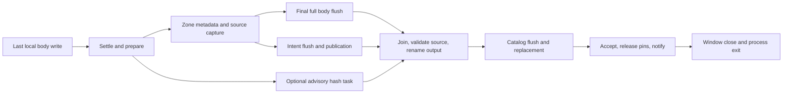

# Remaining finishing waits: source-operation research on 9.74

Five diagnostic downloads now identify where the current source spends time in file writes, body/intent flushing, catalog persistence and application shutdown. Every output matches the independent size/SHA-256 oracle and saved Complete record, and all payloads were removed. Production source remains **9.74 / extensions 0.73.38**. There is no new app-policy change, installation, release or IDM comparison in this investigation; the previous normal-product speed gate remains failed.

## Collection and scope

The owned diagnostic build retains 38 captured normal core objects and recompiles Core, Queue, Transfer and Duplicates with source-operation timing. The app source is copied byte-for-byte, compiled with existing finishing points enabled, and linked with the normal resource. Private header copies add timing around body operations, joins and source capture; an 8,192-event mapped ring records QPC/thread pairs. The helper preserves Win32 last-error state around its own records. Instrumented successful metadata close still makes one close attempt and invalidates the local handle; no persistence strategy, retry rule or flush flag is changed.

The first linked diagnostic used a normally compiled App entry. It was never launched by the controller and was superseded for shutdown coverage by the App-traced link. One later Transfer-only link adds data-only call timing after the initial split catalog reported seven unbracketed drainage calls. Both binary identities and their source/object selections remain recorded. The new call scope is not an app performance improvement or a normal-product comparison.

Each invocation owns a fresh catalog/output folder, unique instance tag and loopback origin. The first three request `--background`; the fourth uses the normal visible-window launch path for a 4 MiB control. This describes the requested branch, not a screenshot-based desktop verification. A fifth, separate split run expands the data-only scope. No native build runs during transfers. Process-exit handles, saved completion, byte hashes and a separate post-exit output flush remain checked. The source observer, trace mapping and display mode can affect timing, so these samples must not be ranked against the uninstrumented matrix or treated as statistical medians.

All five rings have zero dropped records and complete ready slots. The read-only analyzer reconstructs each raw ring from its lossless encoding, checks hashes/headers/PIDs, binds every interval to recorded same-thread endpoints, checks nested catalog operations and validates the actual launch/output/catalog arguments. Eight corrupted-evidence controls reject altered scope, duplicate cases, invented spans, changed binary identity, false payload receipts, extra catalog transactions, corrupt encoding and a lost-event header with a recomputed encoding hash. These controls launch no target and create no payload.

## Measured file-operation dependencies

Milliseconds, one instrumented sample per row:

| Sample | Final full body flush | Intent persistence | Body/intent overlap | Canonical catalog persistence | Catalog temporary flush | Catalog replacement |
| --- | ---: | ---: | ---: | ---: | ---: | ---: |
| Hidden 4 MiB sequential | 45.281 | 46.544 | 45.240 | 26.765 | 13.515 | 11.826 |
| Hidden 64 MiB sequential | 138.550 | 130.431 | 130.431 | 33.306 | 18.885 | 12.944 |
| Hidden 64 MiB split, initial scope | 211.636 | 203.541 | 203.541 | 34.729 | 21.261 | 11.748 |
| Visible-launch 4 MiB sequential | 50.793 | 52.292 | 50.793 | 31.002 | 16.985 | 12.563 |
| Hidden 64 MiB split, expanded scope | 93.708 | 128.380 | 93.708 | 35.105 | 21.228 | 12.150 |

These are overlapping intervals, not additive independent costs. In the 64 MiB sequential sample, the owner joins the remaining body operation for 8.113 ms after intent persistence. The final catalog then runs after body confirmation and source publication. Publishing the intent's temporary file itself takes 32.335 ms after its 96.268 ms temporary-file flush; the catalog subsequently has both a flush and replacement cost. A metadata investigation therefore must include namespace publication, not only `FlushFileBuffers` duration.

The source confirms three invariants in these successful samples:

- Exactly one canonical catalog transaction starts after the last local body write. There is no additional finishing/shutdown catalog rewrite to remove in these cases.
- Each run makes three pinned catalog reads, about 0.045–0.066 ms each. They do not explain the observed large file-operation intervals.
- No atomic replacement retry/backoff occurs. Reducing the retry schedule would not address these observations.

These findings are limited to fresh single-job fixtures, not every user catalog or failure scenario. The reads and fallback saves still protect other cases and must not be deleted based on these results.

## Drainage during reception

The initial split sample's saved statistics report seven successful data-only calls, totaling about 685.6 ms, with a longest call of 174.1 ms. That route was not bracketed by the initial full-flush hook, which is why a separate source scope was added rather than treating an empty full-prefinish list as no drainage.

The expanded sample captures all seven optional calls, matching its saved operation count with zero errors. Durations are 175.0, 27.6, 63.3, 145.9, 177.3, 147.0 and **534.7 ms**. Their sum agrees with the saved approximately 1.271 seconds of optional work. These run during reception; they must not be added serially to the final flush or total download time.

Of 270 positioned-write call envelopes, 181 overlap at least one drainage interval. The longest overlapping write lasts 260.3 ms; the longest write overall lasts 268.7 ms. The drainage worker is already idle at finishing, with a roughly 0.090 ms final join. This is an interaction to investigate, not proof that a particular drainage call caused a particular write stall. API intervals include possible scheduling delay, and no kernel queue, filesystem-filter or hardware-cache attribution follows.

The expanded split exits 232.4 ms after the last origin send versus 344.9 ms in the earlier scope, even though drainage policy is unchanged. That variation is another reason not to call these diagnostic samples a speed improvement or select the faster one as a passing gate.

## Shutdown is a separate interval

The completion notification reaches the close handler in roughly 0.095–0.173 ms. The successful path is using its immediate event, not waiting for the 500 ms retry timer. Integration stop is about 0.15–0.35 ms and Manager stop is below 1 ms in these fixtures.

The interval around `CFrameWnd::OnClose` after the explicit window-cleanup marker is about 12.8–14.5 ms in the initial hidden runs and 25.7 ms in the visible-launch control. This includes synchronous window destruction/callback work; it does not identify animation, a graphics driver or a particular callback as the cause. The visible control still reaches actual process exit about 50 ms after exclusive file availability. GUI teardown must remain separate from publication barriers when assessing complete application lifetime. No timer or exit-policy change is admitted from a single visible sample.

## Corrections and next work

Preparation first rejected a private close-instrumentation anchor because it omitted the existing `temporary-flushed` callback. No compiler had run; the corrected copy preserves the callback. The first runtime decoder then rejected `catalog-resolve-end`, and inspection also identified `publication-cleanup-end` as a one-sided checkpoint. The original trace/transfer receipt and initial driver are retained. The corrected decoder validates that saved 4 MiB run offline; its verified payload had already been removed, and the download was not repeated. Both corrections are recorded separately from successful collection.

The optional-drain control below has since been completed: [all six matched transfers](optional-drain-control-9.74.md) lose finishing and total time when split drainage is removed. Retain the current policy. Kernel attribution remains open. The original bounded next-step choices were:

1. Correlate body writes, optional data-only calls, intent publication and the final catalog with a qualified current kernel recording. The previous temporary diagnostic worker has a stopped receipt and its recorded PID is absent; this investigation did not reopen it or start a new elevation request. Validate collector coverage before asking for one fresh bounded session.
2. Test a separate owned control with only optional split drainage disabled, keeping the mandatory final full flush, range-credit rules, publication journal and accepted catalog unchanged. Compare both reception and finishing, including total process lifetime and post-exit flush. This would test the interaction seen above; it must not become a new timing threshold, a selected favorable rerun or an admitted policy without complete evidence. The earlier [data-writeback results](data-writeback-8.66.md) and [metadata write-through losses](metadata-write-through-investigation-9.64.md) remain relevant controls.

Current source-entry/name-rename ownership gaps, installed validation, current IDM comparison and broad inside/outside parity remain open. No stronger completion claim follows from this trace.

## Evidence and cleanup

[Main analysis](validation/storage-timeline-9.74/main/analysis.json), [all four initial-scope runs](validation/storage-timeline-9.74/main/runs.json), [expanded data-only analysis](validation/storage-timeline-9.74/data-only/analysis.json), [expanded run](validation/storage-timeline-9.74/data-only/runs.json), [negative controls](validation/storage-timeline-9.74/main/analyzer-checks.json), [offline decoder correction](validation/storage-timeline-9.74/main/cases/single-4m/offline-decode-inputs.json), [diagnostic source changes](validation/storage-timeline-9.74/main/inputs.json), [final audit](validation/storage-timeline-9.74/final-audit.json).

The five verified payloads total **200 MiB** and were removed immediately before decoding. After lossless trace export, twenty generated executables, objects and raw rings were individually hash/path/type checked and removed without recursion: another 315,959,830 logical bytes. Combined logical length is 525,675,030 bytes (about 501 MiB), including hard-link names; physical space reclaimed was not measured. Small private metadata and sanitized evidence remain. All 691 normal inputs, five native products, 42 referenced core objects and eleven protected installed/catalog/helper files match their captured hashes. No shared media helper was copied or removed.
